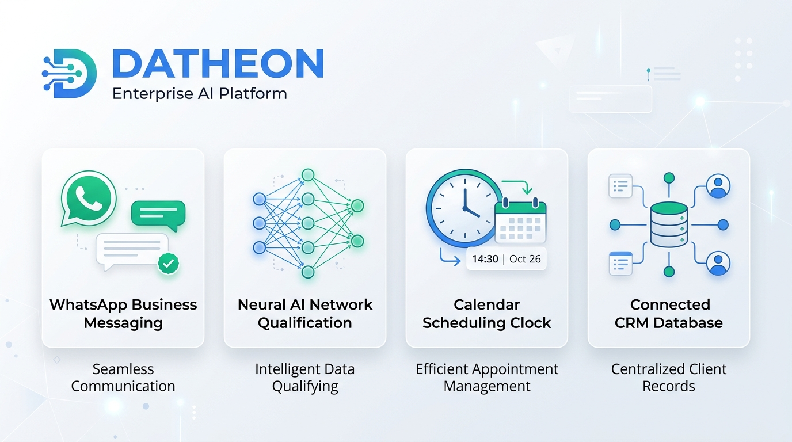
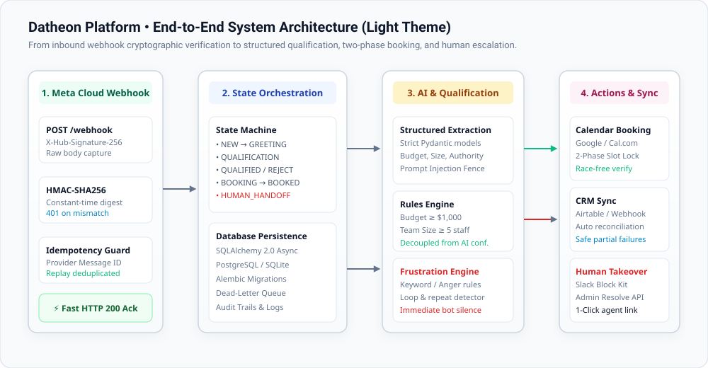
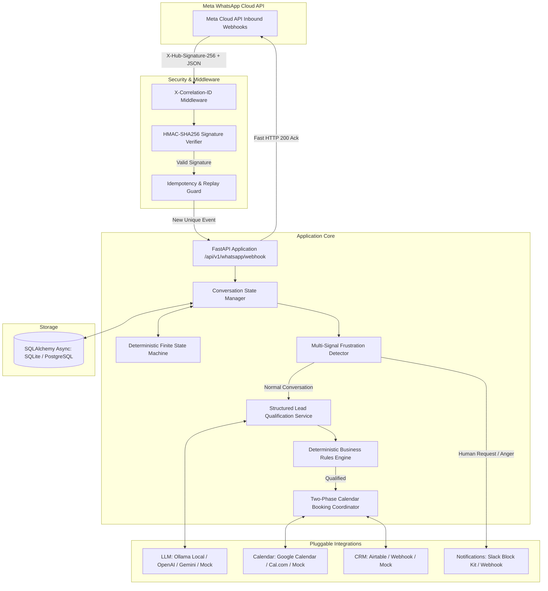
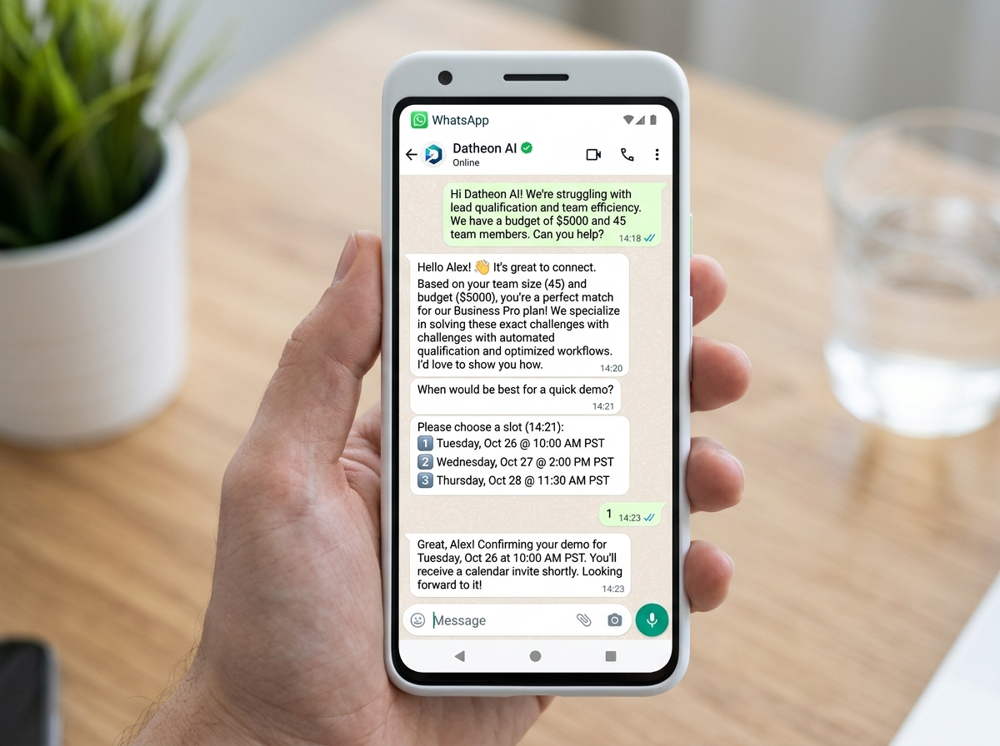
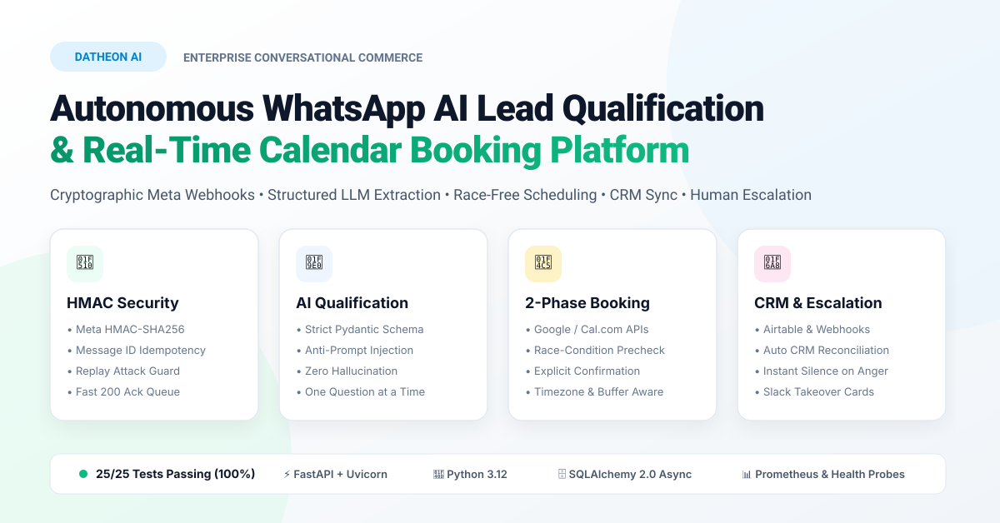

# Datheon Autonomous WhatsApp AI Lead Qualification, Calendar Booking & Human Escalation Platform

<p align="center">
  
</p>

<p align="center">
  <a href="https://www.python.org/"></a>
  <a href="https://fastapi.tiangolo.com/"></a>
  <a href="#-automated-test-suite"></a>
  <a href="LICENSE"></a>
  <a href="#-linkedin-project-showcase"></a>
  <a href="https://github.com/astral-sh/ruff"></a>
</p>

An enterprise-grade, secure, and production-ready Python backend platform built for **Datheon** that automates inbound WhatsApp business conversations, qualifies commercial leads using structured LLM outputs and deterministic business rules, books calendar demonstrations with race-condition prevention, synchronizes CRM records with failure reconciliation, and dynamically escalates frustrated clients to human sales representatives.

---

## 📑 Table of Contents
- [🏛️ System Architecture](#️-system-architecture)
- [💬 Conversational Experience](#-conversational-experience)
- [🚀 Key Architectural Features & The 4 Tasks](#-key-architectural-features--the-4-tasks)
- [📱 LinkedIn Project Showcase](#-linkedin-project-showcase)
- [🛠️ Quickstart & Setup Guide](#️-quickstart--setup-guide)
- [🧪 Automated Test Suite](#-automated-test-suite)
- [📡 API Reference](#-api-reference)
- [🛡️ Security & Threat Modeling](#️-security--threat-modeling)
- [📄 License & Attribution](#-license--attribution)

---

## 🏛️ System Architecture

The platform is designed around strict separation of concerns, complete decoupling between LLM reasoning and deterministic business execution, and zero unhandled failure modes.

<p align="center">
  
</p>

### Detailed Component Flow



---

## 💬 Conversational Experience

Here is a side-by-side walkthrough of the qualification, booking, and human escalation experience:

<p align="center">
  
</p>

---

## 🚀 Key Architectural Features & The 4 Tasks

### 1. Task 1: WhatsApp Webhook Architecture & Cryptographic Verification
- **GET Handshake**: Responds to Meta's subscription challenge (`hub.mode == "subscribe"` and `hub.verify_token`) with exact integer challenge and HTTP 200.
- **POST Authenticity**: Validates `X-Hub-Signature-256` header over the exact raw body using HMAC-SHA256 with the Meta App Secret in constant time (`hmac.compare_digest`).
- **Idempotency & Deduplication**: Provider message IDs (`wamid.xxx`) are deduplicated with database uniqueness constraints, preventing duplicate responses or accidental double bookings on network re-deliveries.
- **Persistent State Machine**: State persists across restarts in SQLAlchemy async models (`conversations`, `messages`, `leads`, `bookings`, `escalation_events`, `dead_letter_events`).
- **Legal Stage Lifecycle**: Strictly enforces transitions:
  `NEW -> GREETING -> QUALIFICATION -> QUALIFIED -> BOOKING -> BOOKED -> HUMAN_HANDOFF -> CLOSED`.

### 2. Task 2: Structured Qualification & Guardrails
- **Strict Pydantic Output Validation**: Enforces `budget` (numeric amount, currency, status), `company_size` (employee count, range), `problem_urgency` (`LOW`, `MEDIUM`, `HIGH`, `CRITICAL`), `decision_maker` (`YES`, `NO`, `UNKNOWN`), `purchase_timeline`, and confidence scores.
- **Prompt Injection Defense**: Customer inputs are strictly fenced within `<CUSTOMER_INPUT>` delimiters with instructions prohibiting instruction overrides, system prompt disclosure, or unauthorized qualification bypasses.
- **Zero Hallucination**: Unknown fields are explicitly marked as `UNKNOWN` or `null`; never fabricates contact info or budgets.
- **Conversational Ergonomics**: Asks only **one concise follow-up question at a time**.
- **Configurable Rules Engine**: Qualification is determined by deterministic business logic (`budget >= $1000`, `company_size >= 5`, `decision_maker != NO`), completely independent of the model's confidence score.
- **Pluggable LLM Providers**: Supports local open-weights models via **Ollama**, cloud models via **OpenAI** and **Google Gemini**, and a deterministic offline **Mock LLM Provider** requiring zero API keys.

### 3. Task 3: Two-Phase Calendar Booking & CRM Reconciliation
- **Two-Phase Booking Protocol**:
  1. *Presentation*: Queries available slots respecting working hours (09:00 - 18:00 UTC), minimum notice (2 hours), meeting duration (30 mins), and buffers (15 mins). Generates numbered options (1, 2, 3) in WhatsApp format.
  2. *Confirmation*: Requires explicit customer reply ("1", "Option 1"). Immediately re-verifies slot availability to prevent race conditions before confirming the booking.
- **CRM Synchronization**: Automatically syncs lead record and booking status to **Airtable** or external CRM webhooks.
- **Partial Failure Reconciliation**: If the CRM is temporarily unreachable, the calendar booking is preserved locally with `CRMSyncStatus.FAILED`, and the asynchronous reconciliation worker retries synchronization with bounded exponential backoff.

### 4. Task 4: Monitoring, Escalation & Observability
- **Multi-Signal Escalation**: Combines keyword triggers (e.g. "human", "agent", "representative", "scam", "lawyer"), negative sentiment analysis, and loop detection (>3 repeated unhelpful turns).
- **Immediate Autonomous Cessation**: Upon escalation, autonomous bot replies halt immediately, preserving the complete conversation transcript and dossier for the human team.
- **Team Alerts**: Dispatches Slack Block Kit cards or webhooks with customer details and conversation context.
- **Admin Management API**: Endpoints at `/api/v1/escalations` allow human staff to review incidents, resolve escalations, and optionally resume automation.
- **Observability**: Structured JSON logging with request correlation IDs (`X-Correlation-ID`), Kubernetes liveness/readiness probes (`/health/live`, `/health/ready`), and Prometheus metrics (`/metrics`).

---

## 📱 LinkedIn Project Showcase

A comprehensive technical breakdown and ready-to-publish social showcase is included in this repository for engineers and hiring managers:

- **Full Post Copy**: Read [`linkedin.md`](linkedin.md) (or [`linked in.md`](linked%20in.md))
- **Featured Image Asset (PNG)**: [`image.png`](image.png) or [`assets/linkedin_post.png`](assets/linkedin_post.png)
- **Vector Banner (SVG)**: [`linkedin.svg`](linkedin.svg) or [`assets/linkedin_banner.svg`](assets/linkedin_banner.svg)

<p align="center">
  <a href="linkedin.md">
    
  </a>
</p>

---

## 🛠️ Quickstart & Setup Guide

### 1. Requirements
- Python 3.12+
- Git

### 2. Installation
```powershell
# Clone the repository
git clone https://github.com/rajeshwari229080/Datheon_Autonomous_WhatsApp_CRM_Lead_Qualification_Bot.git
cd Datheon_Autonomous_WhatsApp_CRM_Lead_Qualification_Bot/rw

# Install dependencies
python -m pip install -e .
python -m pip install pytest pytest-asyncio alembic aiosqlite greenlet
```

### 3. Environment Configuration
Copy `.env.example` to `.env`:
```powershell
cp .env.example .env
```
Key configuration parameters:
| Variable | Description | Default |
| :--- | :--- | :--- |
| `WHATSAPP_VERIFY_TOKEN` | Token entered in Meta Webhook Dashboard | `your_meta_webhook_verify_token_here` |
| `WHATSAPP_APP_SECRET` | Meta App Secret for HMAC-SHA256 signature verification | `your_meta_app_secret_here` |
| `DATABASE_URL` | Async database connection string | `sqlite+aiosqlite:///./datheon_platform.db` |
| `LLM_PROVIDER` | LLM choice (`mock`, `ollama`, `openai`, `gemini`) | `mock` |
| `CALENDAR_PROVIDER` | Calendar choice (`mock`, `google`, `calcom`) | `mock` |
| `CRM_PROVIDER` | CRM choice (`mock`, `airtable`, `webhook`) | `mock` |
| `NOTIFICATION_PROVIDER` | Alert choice (`mock`, `slack`, `webhook`) | `mock` |

### 4. Run Database Migrations
```powershell
alembic upgrade head
```

### 5. Start Application Server
```powershell
python -m uvicorn app.main:app --host 0.0.0.0 --port 8000 --reload
```

---

## 🧪 Automated Test Suite

Run the complete test suite across all four core pillars:
```powershell
python -m pytest tests/ -v
```

### Test Execution Report
```text
============================= test session starts =============================
platform win32 -- Python 3.12.10, pytest-9.1.1, pluggy-1.7.0
rootdir: D:\intership\Datheon_Autonomous_WhatsApp_CRM_Lead_Qualification_Bot\rw
configfile: pyproject.toml
plugins: asyncio-1.4.0

tests/e2e/test_end_to_end_flow.py::test_health_and_prometheus_metrics PASSED [  4%]
tests/e2e/test_end_to_end_flow.py::test_complete_qualification_to_booking_e2e PASSED [  8%]
tests/e2e/test_end_to_end_flow.py::test_complete_frustration_escalation_e2e PASSED [ 12%]
tests/unit/test_booking.py::test_unqualified_cannot_book PASSED          [ 16%]
tests/unit/test_booking.py::test_present_slots_success PASSED            [ 20%]
tests/unit/test_booking.py::test_confirm_slot_booking_success PASSED     [ 24%]
tests/unit/test_booking.py::test_concurrent_slot_race_condition PASSED   [ 28%]
tests/unit/test_booking.py::test_crm_partial_failure_and_reconciliation PASSED [ 32%]
tests/unit/test_escalation.py::test_frustration_detection_keywords PASSED [ 36%]
tests/unit/test_escalation.py::test_human_request_triggers_escalation_and_halts_autonomous_replies PASSED [ 40%]
tests/unit/test_escalation.py::test_resolve_escalation_and_resume_automation PASSED [ 44%]
tests/unit/test_qualification.py::test_extraction_valid_qualified_lead PASSED [ 48%]
tests/unit/test_qualification.py::test_extraction_low_budget_disqualified PASSED [ 52%]
tests/unit/test_qualification.py::test_extraction_small_company_disqualified PASSED [ 56%]
tests/unit/test_qualification.py::test_extraction_missing_fields_one_question_at_a_time PASSED [ 60%]
tests/unit/test_qualification.py::test_prompt_injection_defense PASSED   [ 64%]
tests/unit/test_qualification.py::test_human_request_detection PASSED    [ 68%]
tests/unit/test_webhook_security.py::test_webhook_challenge_success PASSED [ 72%]
tests/unit/test_webhook_security.py::test_webhook_challenge_invalid_token PASSED [ 76%]
tests/unit/test_webhook_security.py::test_webhook_challenge_invalid_mode PASSED [ 80%]
tests/unit/test_webhook_security.py::test_webhook_post_without_signature_rejected PASSED [ 84%]
tests/unit/test_webhook_security.py::test_webhook_post_with_forged_signature_rejected PASSED [ 88%]
tests/unit/test_webhook_security.py::test_webhook_post_with_valid_hmac_accepted PASSED [ 92%]
tests/unit/test_webhook_security.py::test_webhook_replay_duplicate_delivery_idempotent PASSED [ 96%]
tests/unit/test_webhook_security.py::test_webhook_delivery_status_notifications_handled PASSED [100%]

============================= 25 passed in 3.65s ==============================
```

---

## 📡 API Reference

| Endpoint | Method | Purpose |
| :--- | :--- | :--- |
| `/api/v1/whatsapp/webhook` | `GET` | Meta WhatsApp Cloud API verification challenge |
| `/api/v1/whatsapp/webhook` | `POST` | Meta webhook ingestion with HMAC-SHA256 signature verification |
| `/api/v1/escalations` | `GET` | Lists pending human agent escalations |
| `/api/v1/escalations/{id}/resolve` | `POST` | Resolves escalation and optionally resumes automation |
| `/health/live` | `GET` | Kubernetes / Docker liveness probe |
| `/health/ready` | `GET` | Readiness probe verifying DB, LLM, calendar, and CRM status |
| `/metrics` | `GET` | Prometheus exposition metrics |

---

## 🛡️ Security & Threat Modeling
See [`docs/RISK_REGISTER.md`](docs/RISK_REGISTER.md) for the complete 14-item threat matrix, including mitigations against forged webhooks, replay attacks, prompt injection, data leakage, and calendar collisions.

See [`docs/RUNBOOK.md`](docs/RUNBOOK.md) for operational runbooks, incident response procedures, and token rotation guides.

---

## 📄 License & Attribution
Distributed under the **MIT License**. See [`LICENSE`](LICENSE) for full details.  
Copyright &copy; 2026 Datheon Engineering & Contributors.
