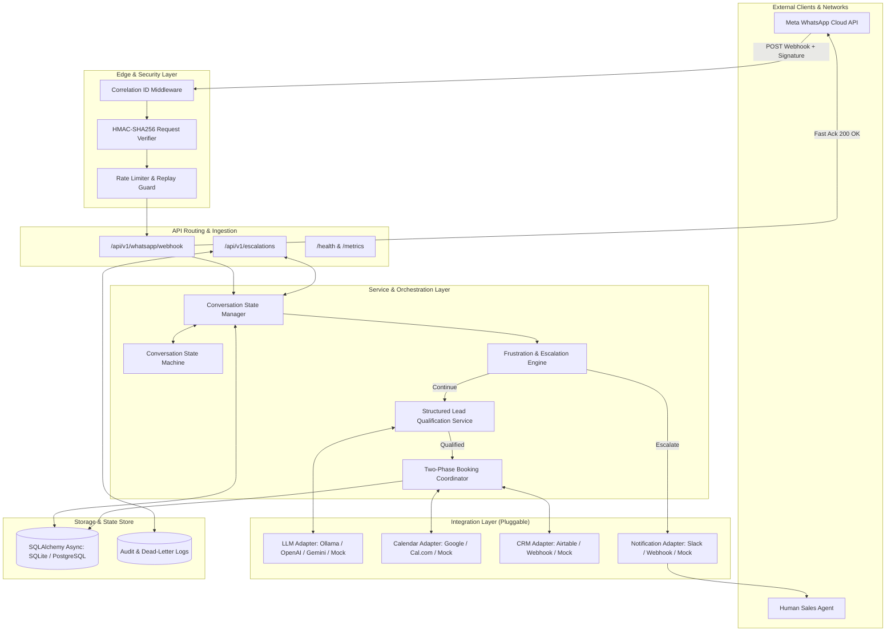
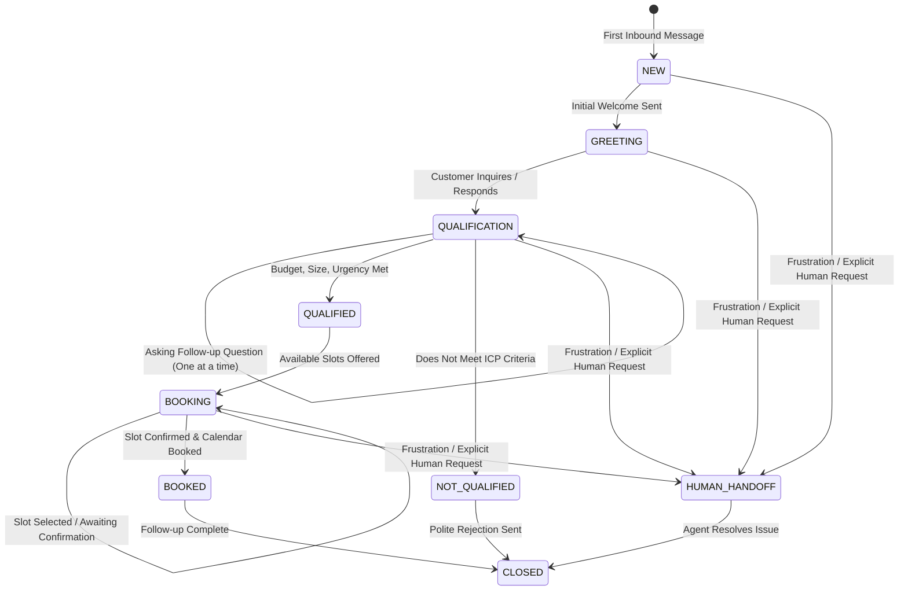

# Datheon WhatsApp AI Lead Qualification, Automated Booking & Human Escalation Platform
## Technical Architecture Specification

### 1. Executive Summary
The Datheon Platform is an enterprise-grade asynchronous backend service designed to automate inbound WhatsApp conversations for high-value business lead qualification, autonomous demonstration booking, CRM synchronization, and intelligent human escalation.

The system uses a layered clean architecture governed by SOLID principles, strict typing with Pydantic V2, asynchronous I/O with FastAPI and SQLAlchemy 2.0, cryptographic request verification, and stateful conversation lifecycle management.

---

### 2. System Architecture Diagram

---

### 3. Core Architectural Principles
1. **Separation of Concerns**: Clean layers separating routing (`api/`), business services (`services/`), database repositories (`db/`), schemas (`schemas/`), and third-party integrations (`integrations/`).
2. **Cryptographic Integrity**: Every inbound POST webhook is cryptographically authenticated using HMAC-SHA256 against Meta's App Secret before any processing occurs.
3. **Idempotency & Replay Protection**: Message identifiers (`wamid.xxx`) are deduplicated with database uniqueness constraints to ensure duplicate delivery from Meta never causes duplicate AI responses or multiple bookings.
4. **State Machine Integrity**: Conversations strictly transition through legal stages (`NEW -> GREETING -> QUALIFICATION -> QUALIFIED -> BOOKING -> BOOKED -> HUMAN_HANDOFF -> CLOSED`). State survives application restarts.
5. **Prompt Injection Defense**: Untrusted customer input is strictly delimited and filtered. LLM outputs are parsed into strict Pydantic models. Any model hallucination or deviation is caught and safely recovered.
6. **Two-Phase Booking**: Time slots are verified for availability before presentation, and re-verified immediately before booking to eliminate calendar race conditions.
7. **Immediate Escalation Cessation**: Upon escalation detection (frustration keywords, negative sentiment loop, or direct human request), autonomous bot replies halt immediately, preserving conversation history and alerting human staff.

---

### 4. Conversation State Machine Lifecycle

