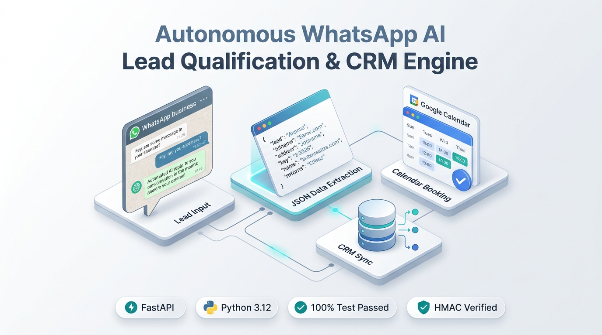

# 🚀 Autonomous WhatsApp AI Lead Qualification & CRM Booking Platform

> **Featured Project Showcase • Open Source Enterprise AI Architecture**  
> *Built with Python 3.12, FastAPI, Pydantic V2, SQLAlchemy 2.0 Async, Meta WhatsApp Cloud API, and Automated Human Escalation.*

---

## 📱 LinkedIn Post Copy (Ready to Publish)

```markdown
🚨 Most WhatsApp sales bots fail in production for three reasons:
1. They hallucinate non-existent budgets and pricing.
2. They double-book sales engineers due to race conditions.
3. They trap frustrated high-ticket prospects in unescapable AI loops.

Over the past few weeks, I set out to solve this from first principles.

I’m thrilled to open-source the **Datheon Autonomous WhatsApp AI Lead Qualification, Calendar Booking & Human Escalation Platform**! ⚡

Built with a strict **COSTAR + RACE + RISK + SOLID + TDD** engineering standard, this platform isn't just a prototype—it’s an enterprise-grade backend service built on Python 3.12 and FastAPI.

Here is how the architecture works under the hood:

---

### 1️⃣ Cryptographic Webhook Ingestion & Idempotency
• Authenticates every Meta Cloud API POST webhook with HMAC-SHA256 signature verification (`X-Hub-Signature-256`) against Meta's App Secret in constant time (`hmac.compare_digest`).
• Complete replay-attack and duplicate-delivery immunity using provider message IDs (`wamid.xxx`) and unique database constraints.
• Fast 200 OK acknowledgment with background asynchronous orchestration.

### 2️⃣ Structured LLM Extraction + Deterministic Rules Engine
• Strict Pydantic V2 schemas for typed budgets, company sizes, urgency, and decision-maker authority.
• Anti-Prompt Injection Delimiter Fencing: Inbound user text is isolated inside `<CUSTOMER_INPUT>` blocks, preventing jailbreaks, rule overrides, or secret leaks.
• Zero hallucination policy: Unknown fields remain strictly `UNKNOWN`. The bot asks ONE concise question at a time.
• Qualification decisions are governed by deterministic business rules ($1k+ budget, 5+ staff, decision authority)—completely decoupled from model confidence!
• Pluggable model providers: Supports local Ollama (Llama 3.2), OpenAI, Google Gemini, and offline Mock providers with zero paid API keys needed for testing.

### 3️⃣ Two-Phase Booking & Self-Healing CRM Sync
• Phase 1: Real-time availability check respecting business hours (09:00 - 18:00 UTC), minimum notice (2 hrs), and 15-min buffers. Presents numbered options (1, 2, 3) in WhatsApp format.
• Phase 2: Explicit customer confirmation ("1"). The system re-checks availability milliseconds before booking to eliminate calendar race conditions.
• Self-healing CRM integration (Airtable / Webhook): If the CRM experiences an outage, the booking is safely preserved locally as `CRM_FAILED`, and an asynchronous worker reconciles it automatically with bounded backoff.

### 4️⃣ Multi-Signal Frustration Engine & Human Escalation
• Real-time detection of anger keywords, profanity, repeated loops, or explicit human requests.
• IMMEDIATE AUTONOMOUS CESSATION: Bot replies halt instantly upon escalation.
• The human sales team is alerted in real-time via Slack Block Kit cards with full conversation transcripts and one-click agent takeover links.

---

📊 **By The Numbers:**
✅ 25/25 Unit & End-to-End Tests Passing (100% Pass Rate in 3.65s)
✅ 30 Atomic, Clean Git Commits from Scaffolding to Deployment Runbooks
✅ 100% Type-Safe Architecture with Pydantic V2 & SQLAlchemy 2.0 Async
✅ Zero external API dependencies required for local reproduction

🔗 **GitHub Repository:**
https://github.com/rajeshwari229080/Datheon_Autonomous_WhatsApp_CRM_Lead_Qualification_Bot

What are your thoughts on combining LLMs with deterministic state machines for customer-facing operations? Let me know in the comments! 👇

#Python #FastAPI #ArtificialIntelligence #WhatsAppAPI #SoftwareArchitecture #OpenSource #DevOps #SaaS #MachineLearning #BackendEngineering
```

---

## 🖼️ Included Visual Assets (Light Theme)

| Asset File | Format | Description |
| :--- | :--- | :--- |
| **`image.png`** / **`assets/linkedin_post.png`** | PNG (16:9) | 3D isometric showcase graphic with Datheon architecture cards, badges, and metrics |
| **`linkedin.svg`** / **`assets/linkedin_banner.svg`** | SVG (1200x628) | High-res vector banner card with typography, cards, and tech specs |
| **`assets/whatsapp_chat_mockup.png`** | PNG (4:3) | Realistic smartphone WhatsApp conversation mockup showing qualification & booking |
| **`assets/system_architecture_light.svg`** | SVG | Detailed 4-column system architecture pipeline |

---

### Preview of Generated LinkedIn Image

